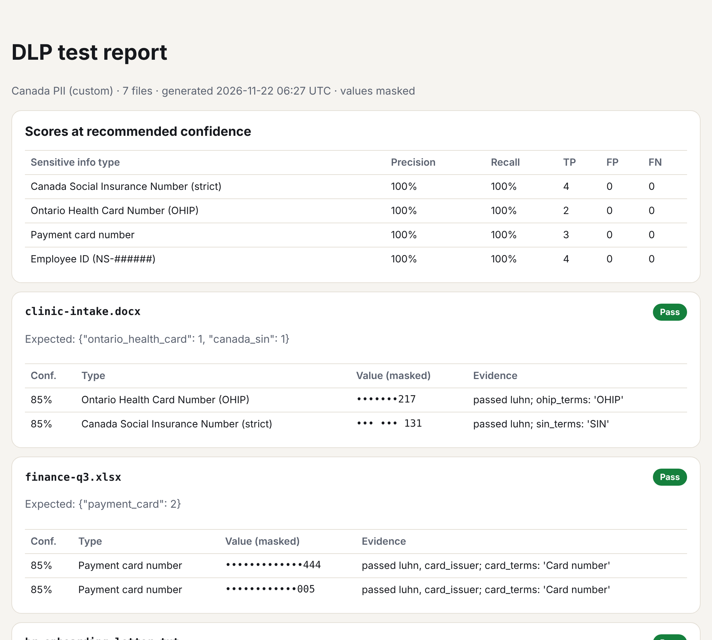

# purview-dlp-tester

[](https://github.com/CadGoose/purview-dlp-tester/actions/workflows/ci.yml)


**Unit tests for your Microsoft Purview DLP rules.** Define custom sensitive information types (SITs) in readable YAML, run them against a folder of sample documents, and see exactly what matches, at what confidence, and why. You get precision and recall *before* a policy goes live and starts blocking payroll's email.

When the results look right, export a Purview rule package XML and upload it.



## Why

Tuning DLP in production is slow and noisy. Each regex change means:
- waiting for the policy to sync
- generating test content in a real mailbox
- reading the Activity Explorer

Meanwhile a loose pattern can flag every 9-digit order number as a SIN, or miss the SINs in a CSV because the keyword sits in the header row.

This tool lets you iterate locally in seconds and keep a regression test set in Git, so a "small tweak" that breaks recall fails CI instead of failing an audit.

## What's included

A ready-to-use **Canada PII** rule pack (`sits/canada.yaml`):

| Sensitive info type | Primary pattern | Validation | Needs keyword nearby |
|---|---|---|---|
| Canada SIN (strict) | `123 456 789` / `123456789` | Luhn | High/medium confidence: *SIN, social insurance, NAS…* |
| Ontario Health Card (OHIP) | 10 digits + optional version code | Luhn | *OHIP, health card, carte santé…* |
| Payment card | 13–19 digit PAN | Luhn + issuer prefix/length | High confidence: *visa, card number, cvv…* |
| Employee ID `NS-######` | org-specific format | none | High confidence: *employee, payroll, HR…* |

A sample document set (`samples/docs`) with an answer key covers .txt, .csv, .docx, .xlsx and .eml files. It includes:
- valid identifiers that **must** match
- Luhn-invalid look-alikes and order numbers that **must not**
- a formatted number with no context, which should only reach low confidence

## Quick start

```bash
pip install git+https://github.com/CadGoose/purview-dlp-tester
git clone https://github.com/CadGoose/purview-dlp-tester && cd purview-dlp-tester

dlp-tester test sits/canada.yaml samples/docs --html report.html
```

```
payroll-export.csv [PASS]
     85%  north_shield_employee_id   ••-•••001              hr_terms: 'Employee'
     75%  canada_sin                 ••••••674              passed luhn; sin_terms: 'SIN'
     ...
Entity scores (at recommended confidence):
  canada_sin                   precision 100.0%  recall 100.0%  (TP 4 / FP 0 / FN 0)
  payment_card                 precision 100.0%  recall 100.0%  (TP 3 / FP 0 / FN 0)
```

Drop the threshold and watch the noise appear:

```bash
dlp-tester test sits/canada.yaml samples/docs --min-confidence 65
# marketing-newsletter.txt [FALSE POSITIVE]   <- "Reference code 098 765 431" with no SIN context
```

Matched values are **always masked** in output, so reports are safe to attach to a ticket.

## Commands

| Command | What it does |
|---|---|
| `dlp-tester check pack.yaml` | Validates the pack: regexes compile, references exist, no look-behind (Purview's regex engine rejects it) |
| `dlp-tester test pack.yaml corpus/ [--html r.html]` | Scans every file and scores against `corpus/expected.yaml`. Exits 1 on any false positive or miss, so it works in CI |
| `dlp-tester scan pack.yaml file.docx` | Ad-hoc scan of one file (or `-` for stdin) |
| `dlp-tester export pack.yaml -o rulepack.xml` | Writes a Purview rule package (UTF-16, as Purview requires) |

Supported files: txt, csv, md, log, json, html, **docx, xlsx, eml** (pure-stdlib parsing) and **pdf** (`pip install "purview-dlp-tester[pdf]"`).

## Writing your own SIT

```yaml
elements:
  regex:
    employee_id: '\bNS-\d{6}\b'
  keywords:
    hr_terms: [employee, payroll, staff id]

entities:
  - id: employee_id
    name: Employee ID
    recommended_confidence: 75
    patterns:
      - confidence: 85            # strongest pattern first
        primary: employee_id
        require_any: [hr_terms]   # any of these within `proximity` characters
      - confidence: 65
        primary: employee_id
```

This mirrors Purview's model: an entity has one pattern per confidence level, and each pattern has a primary element plus supporting elements within a proximity window. Available validators are `luhn`, `card_issuer` and `not_repeating`.

Then add your test files to the corpus and list what *should* match in `expected.yaml`:

```yaml
payroll-export.csv:
  canada_sin: 2              # the third row fails Luhn and must NOT count
marketing-newsletter.txt: {} # nothing should match here
```

## Deploying to Purview

```powershell
Connect-IPPSSession
New-DlpSensitiveInformationTypeRulePackage -FileData ([System.IO.File]::ReadAllBytes("$PWD\rulepack.xml"))
# Updating later:
Set-DlpSensitiveInformationTypeRulePackage -FileData ([System.IO.File]::ReadAllBytes("$PWD\rulepack.xml"))
```

The export contains entities, patterns, regexes, keyword lists, proximity and confidence levels. It does **not** contain checksum validators: Purview's custom XML checksum validator uses a weighted-sum model that can't express Luhn. After uploading, open each SIT in *Purview → Data classification → Sensitive info types → Edit* and enable **Luhn check** under *Additional checks* on the primary element. Then test with Purview's built-in **Test** button using a file from `samples/docs`.

Entity and rule-pack GUIDs are derived from the IDs in YAML, so re-exporting updates the same SITs instead of creating duplicates. See [`docs/rulepack.example.xml`](docs/rulepack.example.xml) for the output.

## Notes

- Matching is local and offline; nothing is uploaded anywhere.
- This approximates Purview's engine closely enough for tuning. Purview's tokenisation and keyword handling differ in edge cases, so always do a final check with the portal's Test feature.
- The sample identifiers are fictitious: SINs start with `0`, a range never assigned to people; cards are the industry test PANs; health numbers are sequential.

---

Built by **George Mkahail** ([@CadGoose](https://github.com/CadGoose)) · [cadgoose.github.io](https://cadgoose.github.io) · MIT License
